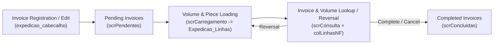

# Product Loading & Shipping Control (Power Apps)

Low-code **Microsoft Power Platform (Power Apps)** solution for managing industrial product loading, invoice (NF) dispatch tracking, and volume-level reconciliation integrated with **SharePoint Lists**.

## Operational Workflow



## Repository Structure

```text
powerapps-carregamentodeprodutos/
├── CarregamentodeProdutos/
│   ├── src/
│   │   ├── CanvasApps/          # Exported Canvas App source metadata
│   │   └── Other/               # Solution manifest and configuration files
│   └── .gitignore
├── telas/
│   └── Screens.txt              # Consolidated Power Fx / YAML definitions for all screens
└── README.md
```

## Application Screens (`telas/Screens.txt`)

All screen definitions and Power Fx formulas are consolidated in `telas/Screens.txt`:

| Screen | Operational Responsibility |
| --- | --- |
| `scrPendentes` | Lists open/pending invoices awaiting loading and dispatch |
| `scrCarregamento` | Registers loaded volumes by serial number or individual piece |
| `scrConsulta` | Searches by invoice (NF) or volume, applies filters, and reverses individual loaded volumes |
| `scrConcluidas` | Displays completed/closed invoices for operational audit and history |

## Data Sources & Collections

- **SharePoint Lists:**
  - `expedicao_cabecalho` — Invoice/dispatch header records (status, metadata, completion/cancellation state)
  - `Expedicao_Linhas` — Line-level loaded volumes linked to each invoice
- **In-Memory Collection:**
  - `colLinhasNF` — Local screen collection used during invoice volume inspection and validation

## Purpose

This repository serves as readable documentation and versioned backup of the Canvas App architecture, screen definitions, and Power Fx business rules for shipping dispatch control.
